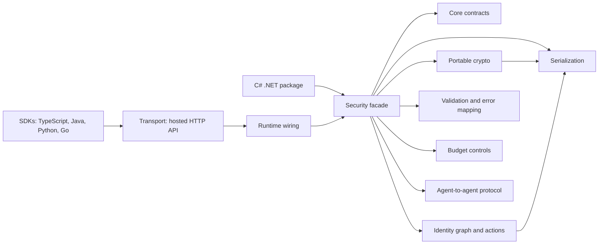

# Aegir Architecture Overview v0.1.1-beta.1

Status: Beta-1 documentation baseline.

## High-Level Subsystem Diagram

## Core

Core is the shared contract layer for the compact Beta-1 SDK surface. It contains the public model concepts used across languages: identity graph records, exposure records, action records, diagnostics event shapes, error codes, budget envelope shapes, and safe-envelope contracts. Core responsibilities are intentionally small: define stable data shapes and avoid host-only runtime concerns.

Public surface:

- Identity, exposure, action, diagnostics, safe-envelope, budget, and A2A models.
- Typed enums for action, graph, exposure, operational-control, and error-code values.

## Crypto

Aegir's cryptography runs **server-side**. The SDK calls the API and relays results; it performs
no security-bearing cryptography of its own.

- Protected agent-to-agent payloads: **ML-KEM-768** + **AES-256-GCM**, signed **ML-DSA-65**.
- Transaction receipts: **ML-DSA-65**, verifiable after the signing key is retired.
- Device handoff proof: **ML-DSA-65** against an enrolled device public key.
- Access tokens: HS256 JWT.

### Portable helpers (deprecated)

The SDKs also expose deterministic portable helpers, retained for cross-language parity tests and
local fixtures:

- `signChallengePayload` / `verifyChallengePayload`
- `signProofReceiptPayload` / `verifyProofReceiptPayload`
- `signIdentityTokenPayload` / `verifyIdentityTokenPayload`
- `TrustCoreAlgorithmDescriptor`
- `TrustCoreSignatureEnvelope`

> **These helpers are not Aegir's cryptography.** They are a deterministic, **keyless**
> digest: anyone who knows the algorithm - and it is published here, in five languages - can
> produce a matching value. They therefore prove nothing about possession of a key, and they must
> not be used to authenticate anything or to establish integrity against an adversary.
>
> They exist for cross-language parity tests and local development fixtures, and are kept in
> Beta-1 only so existing callers keep compiling. Treat them as deprecated.

## Identity

Identity owns the graph and action model exposed to SDK consumers. It provides scans, graph snapshots, exposure summaries, action execution, action reversal, and action history.

Public surface:

- `ScanIdentityResult`
- `IdentityGraphSnapshot`, `IdentityGraphNode`, `IdentityGraphEdge`, `IdentityGraphScores`
- `ExposureSummary`, `ExposureFinding`
- `PerformIdentityActionRequest`, `IdentityActionRecord`
- Identity action, graph node, graph edge, exposure category, and exposure severity enums.

## Validation

Validation covers public request validation and result validation at SDK boundaries. Beta-1 validation includes required option checks, request payload shape checks, safe-envelope payload hash checks, missing-signature checks, budget exhaustion checks, and HTTP/API error-code mapping.

Public surface:

- Safe-envelope validation result models.
- Language-specific security client error wrappers.
- Language-specific budget exhaustion errors.

## Serialization

Serialization standardizes the public wire contract. The Beta-1 JSON contract uses camelCase fields, PascalCase public identity/exposure enum values, lower_snake_case `AegirErrorCode` values, ISO-8601 UTC timestamps, and dictionaries/maps for metadata.

Public surface:

- Public DTOs serialize to the same JSON wire shapes across C#, TypeScript, Java, Python, and Go.
- SDKs keep idiomatic type names while preserving field names and enum string values.

## Transport

Transport is the hosted C# HTTP API consumed by external SDK clients. The public SDK clients call `/v1/security/*` endpoints and attach optional configuration and developer keys.

Public operations:

- `GET /v1/security/scan/{subjectId}`
- `GET /v1/security/graphs/{subjectId}`
- `GET /v1/security/exposure/{subjectId}`
- `POST /v1/security/actions`
- `POST /v1/security/actions/{actionId}/reverse`
- `GET /v1/security/actions/history/{subjectId}`

## Runtime

Runtime wires the public services into executable behavior. For Beta-1, runtime includes the in-memory public implementations used by SDK consumers and tests: the C# provider, safe-envelope service, budget envelope service, and A2A protocol. Host, web, MCP, admin, developer, KYC, billing, persistence, OIDC, proof-ledger, and app-only services are not part of the public SDK surface.

Public surface:

- `IAegirSecurityProvider` / `AegirSecurityProvider`
- `AegirSecurityHttpClient`
- `ISafeEnvelopeService` / `SafeEnvelopeService`
- `IBudgetEnvelopeService` / `InMemoryBudgetEnvelopeService`
- `IAgentToAgentProtocol` / `InMemoryAgentToAgentProtocol`

## Security

Security is the public facade that combines identity operations, portable crypto, safe envelopes, diagnostics, budget envelopes, and A2A message exchange. It is the subsystem most SDK users interact with directly.

Public surface:

- Security clients/providers.
- Portable crypto helpers.
- Safe-envelope helpers.
- Budget envelope helpers.
- Diagnostics hooks.
- A2A protocol helpers.

## SDK Interaction With The C# Host

The C# host is the authoritative runtime for identity scan, graph, exposure, and action operations. TypeScript, Java, Python, and Go clients call the hosted HTTP surface for those operations. Portable helpers are implemented locally in every SDK so callers can create and validate safe envelopes, sign and verify deterministic trust-core payloads, enforce in-memory budget envelopes, and exchange A2A message records without a host round trip.

## Portable Crypto And A2A Protocol

Portable crypto signs canonical byte payloads and verifies them using the same deterministic algorithms in all languages. Safe envelopes bind a canonical payload string to a payload hash and optional signature envelope. A2A messages wrap canonical payloads in safe envelopes and validate them on receipt.

Public A2A receive reasons:

- `accepted`
- `message_not_found`
- `payload_hash_mismatch`
- `signature_missing`

## Excluded From Beta-1 Public SDK Surface

The following responsibilities remain host/internal responsibilities and are intentionally excluded from the Beta-1 SDK contract: admin portal APIs, developer portal APIs, billing, storage/persistence, proof-ledger internals, KYC, OIDC, device management, recovery, organization management, trust-token issuance, MCP transport internals, and web/app UI runtime models.
